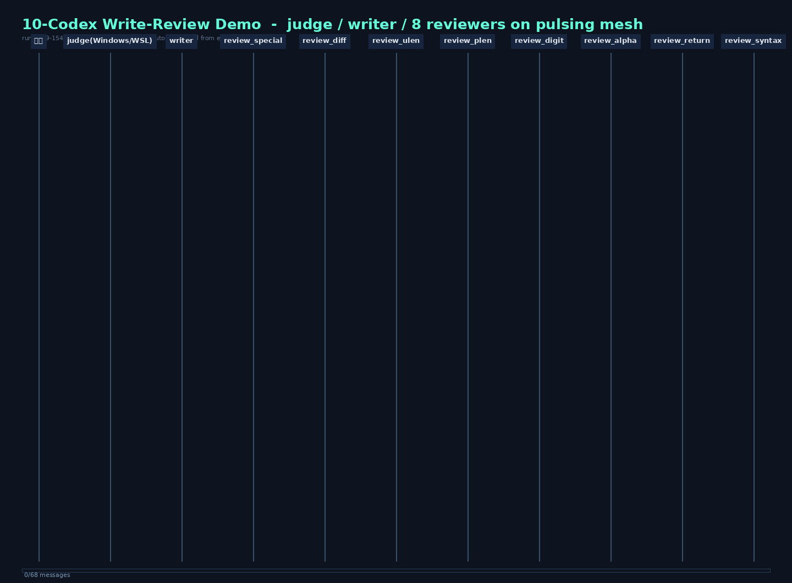

# demo10 — 10 个 Codex 的写审协作 Demo（一键运行）



> 上面的动画由**真实运行的事件账本自动生成**（非示意图）：1 个 judge 指挥 + 1 个 writer 写码 +
> 8 个专项审查店，共 10 个 codex 会话在 pulsing mesh 上协作——派单 → 交稿 → 群发审查 →
> 抓漏打回 → 修正 → 复审 → 汇报。全程信件落账，跑完自动生成时序图并做 22-39 项通信审计。
>
> 实测背书：双机（笔记本/台式机 WSL）累计 10+ 轮压测，**通信协议层审计 7/7 轮满分**。

## 快速开始（三行）

```bash
git clone -b demo_review https://github.com/Damon6666/codex.git
cd codex/pulsing-demo/demo10
export ZHIPU_API_KEY=<你的key>     # https://open.bigmodel.cn 申请
./run.sh
```

**前置条件**：Linux 或 WSL2 · python3 ≥ 3.8（零 pip 依赖）· curl · 智谱 API key ·
codex-pulsing 二进制（见下）。模型默认 `glm-5.3`（`MODEL=xxx ./run.sh` 可换）。

**codex-pulsing 二进制**（内置 pulsing 的 codex fork，run.sh 按序自动查找）：
1. `./codex-pulsing` — 预编译版放到本目录（推荐，见仓库 Release）
2. `codex-rs/target/release/codex` — 自编译：仓库根目录 `cargo build --release -p codex-cli`（需 rust ≥ 1.95 + clang，约 1-2 小时）
3. `CODEX_BIN=/path/to/codex` 显式指定

## 运行时你会看到

- 每 15 秒一行实况（派单 / 审查店回信 / 打回修改 …），单轮 2-15 分钟
- 结束后 `runs/run-<时间戳>/` 自动归档：
  - `sequence-diagram.html` — 浏览器打开即看全量时序图（一封信一条箭头）
  - **通信审计报告** — 22-39 项检查：组网完整性 / 通信对象合法性 / fanout 覆盖 /
    发信时序闸门 / 图-事件一致性，逐项 PASS/FAIL
  - `events-*.jsonl` 全部信件原始账本
- 实时大屏（可选）：`python3 ../tools/watch-all.py runs/run-<时间戳> --web-port 8787`
- 展示页：浏览器打开 [showcase.html](showcase.html)（实况动画 + 时间线解说）

## 三个剧本（TEAM 环境变量切换）

| 剧本 | 用法 | 轮数 | 特点 |
|---|---|---|---|
| **validate** | `TEAM=team-single10-validate.toml` | 恒 1 轮 | 注册校验函数审查；5 轮压测 22/22×5 满分，90-270 秒稳定收尾，**展厅保底** |
| **fixloop**（默认） | `TEAM=team-single10-fixloop.toml`（不设 TEAM 即此剧本） | 2-4 轮 | 任务故意少写两条领域标准约束，审查店精准抓漏 → 打回 → 修正 → 复审；带防刷屏纪律（每轮唯一一封打回信） |
| **loop** | `TEAM=team-single10-loop.toml` | 1-5 轮 | 埋雷剧本（第二行只准纯数字），戏剧性强 |
| greeting | `TEAM=team-single10.toml` | 恒 1 轮 | 极简问候脚本，最短路径 |

## 协作协议（这个 demo 真正展示的东西）

```
用户 ──任务──→ judge ──派单(原文转发)──→ writer
                 ↑                        │
                 │────── 围栏脚本(登记底稿)─┘
                 │
                 ├─ fanout_task(零参数) ──→ 8 家审查店同刻群发
                 │        （底稿逐字嵌入，机器代发保证覆盖与一致性）
                 ↑←── CLEAN / NEEDS_FIX ───┘
                 │
        全 CLEAN → 中文汇报 + 最终脚本 → 收尾
        有 NEEDS_FIX → 汇总打回(每轮一封) → writer 修正 → 复审（循环）
```

结构性保证（非提示词约束）：**底稿登记**（writer 围栏脚本自动入账）、**fanout 闸门**
（无底稿不群发）、**打回闸门**（审查未收齐不打回）、**名册覆盖检查**、**看门狗催办**、
**强制收尾**。审查店永不直连 writer，一切经 judge 仲裁。

## 架构

```
10 个 codex 进程 = 10 个 ActorSystem（每进程: SystemActor + CodexPeer）
                    │  pulsing mesh (SWIM/gossip, 每店一个端口)
10 个 LLM 会话(Agent) 在 actor 系统之外，经 inject_local 与信箱相连
                    │
zhipu-shim.py — 本地零依赖网关：Responses↔chat/completions 双向翻译
                （codex 只说 Responses 方言，智谱只有 chat 方言；
                 含 namespace 工具展平、agent_message 信件映射、SSE 回译）
```

## 工程防御清单（每一行都是实测踩出来的）

| 坑 | 内置防御 |
|---|---|
| 预设 `CODEX_PULSING=1` 组网失败 | run.sh 显式 unset |
| codex exec 卡等 stdin | 统一 `</dev/null` |
| team toml 缺 `[completeness]` 键 → fanout 永远被拒 | 启动时校验，fail-fast |
| worker 进程每轮泄漏 9 个挤爆内存 | 按二进制全量清理 |
| 完成检测误匹配提示词回显（15 秒误杀健康 judge） | 完成判据只看进程退出 |
| 模型调用悬挂收不了尾 | 双判据 + 超时收账 + 审计不受影响 |
| 审查信裸 ``` 围栏歧义 | 职责词与信件模板对齐 |
| judge 连环催促刷屏（12 分钟 18 封） | 打回节奏纪律（每轮一封、两次失败即如实收尾） |
| Windows 提交丢执行位 | 仓库内已为 100755 |

## 压测记录

| 日期 | 场景 | 轮数 | 审计 |
|---|---|---|---|
| 2026-10-29 | validate | 5 | **22/22 × 5 满分** |
| 2026-10-29 | fixloop | 2 | 34/34、22/22 满分 |
| 2026-10-29 | fixloop（台式机 WSL） | 1 | 29/29 满分，防刷屏纪律生效 |
| 2026-10-28 | greeting（文档流程全新克隆） | 1 | 22/22 满分，75 秒收尾 |

已知边界：收尾时刻模型调用悬挂发生率约 1/5（智谱桥抖动，通信层无损，重跑即好）；
fixloop 剧本中 writer 补齐缺失检查的收敛受 glm-5.3 能力限制（协议循环本身完整执行）。

## FAQ

- **必须用智谱吗？** shim 是通用的 responses→chat 翻译层，改 `ZHIPU_URL` 与模型名即可接任何
  OpenAI 兼容服务。
- **能看实时大屏吗？** `python3 ../tools/watch-all.py runs/run-<ts> --web-port 8787` 后浏览器开
  `http://localhost:8787`（时序图每 2 秒自动重绘）。
- **怎么验证通信没造假？** 审计器 `verify.py` 对照事件账本逐项核对；时序图每一箭头都能在
  `events-*.jsonl` 里找到对应信件。
- **换场景？** 团队拓扑/职责/信件模板都在 toml 里，是场景数据——换翻译/设计团队只改 toml，
  代码零改动。

## 目录

```
demo10/
├── run.sh                  # 一键入口（自检→网关→发射→图→审计）
├── zhipu-shim.py           # 零依赖模型网关（~350 行纯标准库）
├── team-single10*.toml     # 四个剧本（默认 validate... 见上表）
├── verify.py               # 通信审计器（22-39 项检查）
├── showcase.html           # 展示页（实况动画 + 时间线）
├── assets/                 # 动画 GIF / 海报 PNG（真实运行数据生成）
└── runs/                   # 每轮产物（时序图/账本/审计, git 忽略）
```
